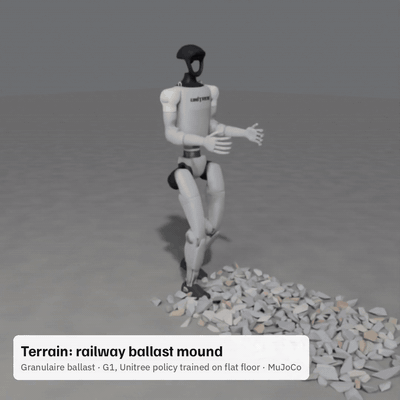
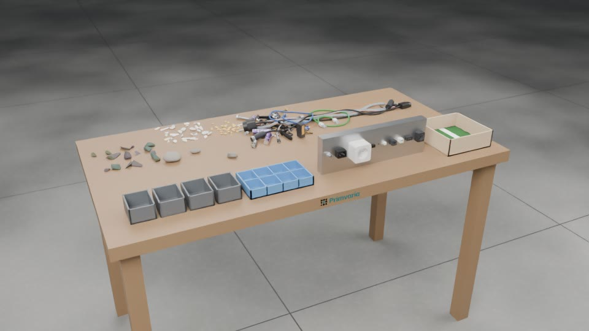

<h1 align="center">
  <picture>
    <source media="(prefers-color-scheme: dark)" srcset="https://raw.githubusercontent.com/drscaon/primvaria/main/docs/images/logo-dark.svg">
    
  </picture>
</h1>

<p align="center"><strong>Physics-ready variability for Physical AI, in OpenUSD.</strong></p>

<p align="center">
  <a href="https://primvaria.com/#demo"></a><br>
  <sub>Same robot, same policy, different grains. <a href="https://primvaria.com/#demo">Watch the one-minute video</a> (generated as OpenUSD, tested in MuJoCo, rendered in Blender).</sub>
</p>

<p align="center">
  <a href="https://github.com/drscaon/primvaria/actions/workflows/ci.yml"></a>
  <a href="https://pypi.org/project/primvaria/"></a>
  
  
  <a href="https://primvaria.com"></a>
</p>

Primvaria is a suite of procedural asset generators for the objects robots
struggle with most: grains, cloth, cables and small mechanical parts. Every
generator follows the same approach: **distributions instead of one shape**
(no two generated instances are the same, and what was drawn is written down
as ground truth), **measured outputs** (mass, shape, stiffness are measured on
what was generated, not trusted from the inputs) and **honest limits** (each
asset is checked in real engines, and what was not tested is said).

Every output is **OpenUSD** with standard `UsdPhysics` schemas and nothing
specific to an engine; what only **NVIDIA Omniverse and Isaac Sim** read
(PhysX settings, OmniPhysics deformables) is a layer over each file: one file format for
Blender, usdview, Omniverse and the other OpenUSD-aware tools, read back into
MuJoCo for the checks. Each generator's README says in which engines its
assets have been tested so far. Everything can run on CPU.

The name comes from *primvar*, OpenUSD's primitive variable, and *varia*,
Latin for "diverse things".

## The generators

| | Generator | Assets | Physics |
|---|---|---|---|
|  | [**Granulaire**](https://github.com/drscaon/granulaire) | sand, gravel, pebbles, seeds, fruit, pellets, packing peanuts; measured shapes, masses and moisture | rigid bodies, pile test in Blender and MuJoCo; deformables for OmniPhysics |
|  | [**Maillage**](https://github.com/drscaon/maillage) | towels, napkins, tablecloths, sheets, scarves, flags; real sizes, fabrics and masses | cloth meshes with engine-neutral stiffness; drape test in Blender and MuJoCo; OmniPhysics surface deformables |
|  | [**Filaire**](https://github.com/drscaon/filaire) | standard cables, BNC coaxial leads, robot and drone leads (servo, battery, balance, jumper) with male and female connectors and the receptacles they plug into | rigid-segment chains with joints; drop, sag, insertion and bayonet-lock tests in MuJoCo, drop in Blender |
|  | [**Quincaillerie**](https://github.com/drscaon/quincaillerie) | metric screws, nuts and washers with modelled threads; battery cells and their holders | rigid bodies, springs and clips; drop, screwing and insertion tests in MuJoCo and Blender |

Each generator is its own package, released on its own schedule. Primvaria
installs them together and gives them one command line.

## Engine matrix

Where each generator stands in each engine (also on
[primvaria.com](https://primvaria.com/#engines)). Tests run in each project's
CI on every preset before each release (on a sample of them on each commit), from the
OpenUSD file alone.

<!-- engines:start -->
| | OpenUSD validators | Blender | MuJoCo | Newton · CPU | Isaac Sim · PhysX | OmniPhysics deformables |
|---|---|---|---|---|---|---|
| Granulaire | tested | tested: pile | tested: pile | tested: mass, settling | not yet | exported, not run |
| Maillage | tested | tested: drape | tested: flex drape | read, mass, drop; drape not converged in Newton | n/a (cloth) | exported, structure checked, not run |
| Filaire | tested | tested: drop (add-on) | tested: drop, sag, coil, insertion, bayonet lock | read, mass; holds its shape, bend set by XPBD's iteration count | not yet | n/a |
| Quincaillerie | tested | tested: drop, assemblies (add-on) | tested: drop, screwing, jam, insertion | tested: mass, drop | not yet | n/a |
<!-- engines:end -->

Newton runs on CPU in this repository's CI (`scripts/newton_check.py`), every
preset of the four generators, with Newton's XPBD solver. Each file is opened
from its Newton layer (`<file>_newton.usda`), which holds what Newton cannot
guess from the standard `UsdPhysics` file: contact gaps, limits on the joint
axes a cable leaves free, battery holders as articulations, cloth in the
schemas Newton reads. The [trial report](docs/trials/newton-cpu.md) gives the
details.

Isaac Sim runs need an NVIDIA RTX GPU and have not been done yet: the files
follow the standard `UsdPhysics` schemas, with the PhysX settings and the
OmniPhysics deformables in a layer over each file.

All four write the same ground and physics scene, so their assets share one
scene: `/World/PhysicsScene` with gravity 9.81 m/s² along −Z, and
`/World/Ground`, a 2 cm box whose top face is z = 0, with the physics material
`/World/GroundMaterial` (static friction 0.6, dynamic 0.5, restitution 0.1).
Each generator checks every file it writes against this convention.

## Installation

```bash
pip install primvaria             # the four generators
pip install "primvaria[all]"      # + renders, MuJoCo checks, MaterialX
pip install "primvaria[blender]"  # + Blender as a Python module (Python 3.13 only)
```

| Extra | Adds |
|---|---|
| `render` | previews and renders (matplotlib, Pillow) |
| `sim` | the MuJoCo checks of all four generators |
| `materialx` | MaterialX materials of Quincaillerie |
| `all` | all of the above |
| `blender` | Blender as a Python module, for the Blender checks of all four (Python 3.13 only, as the `bpy` wheels exist for one Python version; not part of `all`) |

The OpenUSD validators need `usd-core` 26.5 or later, which the generators
require. Only one generator? Install it alone: `pip install granulaire`.

## Usage

```bash
primvaria list                                   # generators and installed versions
primvaria granulaire generate --preset beach_sand
primvaria maillage generate --preset tea_towel
primvaria filaire generate --preset usb_c --length 2
primvaria quincaillerie generate screw M10 --with nut,washer --count 10
primvaria compose scene.usda output/ quincaillerie_output/   # one scene from their outputs
```

`primvaria compose OUT INPUT...` builds one scene from what the generators
wrote: each input is an asset file or a folder searched for them. Every asset
is referenced from its own file (paths relative to the scene, so the scene
moves with the outputs), set on its own spot of the shared ground (in rows,
in the order of the inputs, only shifted along x and y), under one
physics scene, in a scope per generator (`/World/Grains`, `Cloths`, `Cables`,
`Parts`). Assets named alike take their preset's name, and their instance
label follows. The scene itself is plain UsdPhysics; beside it, compose writes
one engine layer per engine the assets have layers for (`scene_newton.usda`,
`scene_physx.usda`, `scene_omniphysics.usda`), which brings each asset's own
engine settings to its place in the scene: open the one of your engine
instead of the scene. `--engines` chooses them, as in the generators. `--limit N` takes at most N assets per
file, `--gap` and `--width` set the spacing and row width in metres. The
command then checks the scene against the contract and exits 1 if it does not
conform (`--no-check` skips it).

[](https://primvaria.com/#bench)
<sub>Assets of the four generators, laid out on a bench by external Blender scripts made for this video, not part of Primvaria: `compose` only sets them side by side. [Watch the video](https://primvaria.com/#bench).</sub>

`primvaria <generator> ...` runs that generator's own command line: it is the
same as typing `granulaire ...`, `maillage ...`, which keep working. From
Python, import the generators directly:

```python
from granulaire import generate_scene, write_outputs

write_outputs(generate_scene("beach_sand"), "output")
```

## Logo

`docs/images/`: the logo (`logo.svg`, `logo-dark.svg`), the mark alone
(`mark.svg`, `mark-dark.svg`, `mark.png`) and the social preview
(`social_preview.png`, 1280 × 640, to upload in Settings > General > Social
preview, also the website's link preview; `social_preview@2x.png`).
The mark is nine primitives, no two alike, the centre one in teal: the suite's
promise in one image. The wordmark is Familjen Grotesk Bold (SIL Open Font
License), drawn as outlines. Regenerate the logo and the website's favicon
with `python scripts/make_logo.py`, and the social preview, built from the four
generators' renders, with `python scripts/make_social_preview.py`.

## Website

[primvaria.com](https://primvaria.com) has one page per subject, built from
`site/` by the `pages.yml` workflow (GitHub Pages):

| Page | Source |
|---|---|
| home, engine matrix | written by hand: `site/pages/` |
| `/contract/`, `/mission/` | `docs/contract.md`, `MISSION.md` |
| `/<generator>/` | the generator's `README.md` |
| `/<generator>/<page>/` | each page of the generator's `docs/` that its README links to |

The site is rebuilt on every change to those files here, and weekly to pick up
what changed in the four generators. The build fails if a link inside the
site leads nowhere. Preview it locally with sibling clones of the four
repositories:

```bash
pip install -e ".[dev]"
python site/build.py --local ..
python -m http.server -d _site
```

## Mission and contract

[MISSION.md](https://github.com/drscaon/primvaria/blob/main/MISSION.md) states
what the suite is for, the three verbs every change is checked against (vary,
measure, prove) and what it does not do.
[docs/contract.md](https://github.com/drscaon/primvaria/blob/main/docs/contract.md)
is the OpenUSD contract the four generators share: stage conventions, the
ground and physics scene, asset identity, semantic labels (the classes
renderers turn into segmentation masks), variant sets, MateFrames, the engine
layers that keep PhysX and OmniPhysics data out of the files, and the pack
files. Its code is written once, in the package
[primvaria-contract](https://github.com/drscaon/primvaria/tree/main/contract)
(folder `contract/`), on which the four generators depend.

## Development

The project follows **GitHub Flow**, like the four generators: `main` is
protected, every change goes through a pull request from a short-lived branch
(`feat/<name>`, `fix/<name>`, …), and CI must be green before merging.
Enable the pre-push hook once per clone with
`git config core.hooksPath .githooks`.

The engine matrix is written once, in `docs/engines.json`. After changing it,
or after a generator gains a preset, run `python scripts/sync_engines.py`: it
rewrites the table above and the website's matrix and counts. A test fails
when they are out of date.

Releasing: on a `chore/release-X.Y.Z` branch, bump `version` in
`pyproject.toml` and move the `Unreleased` entries of `CHANGELOG.md` under
the new version; merge, then tag `vX.Y.Z` on `main`. The release workflow
tests, builds, creates the GitHub release and publishes the package on PyPI
through Trusted Publishing.

primvaria-contract (`contract/`) is released on its own, before the generators
that need its new version: bump `version` in `contract/pyproject.toml`, move
the `Unreleased` entries of `contract/CHANGELOG.md`, merge, then tag
`contract-vX.Y.Z` on `main` (workflow `release-contract.yml`).

## License

[MIT](https://github.com/drscaon/primvaria/blob/main/LICENSE) © 2026 Daniel Régis Sarmento Caon
